<a href="https://github.com/SebastianCastellanos123">
  <picture>
    <source media="(prefers-color-scheme: dark)" srcset="assets/banner-dark.svg">
    <source media="(prefers-color-scheme: light)" srcset="assets/banner-light.svg">
    
  </picture>
</a>

 

---

## `$ whoami`

  

---

## `$ cat stack.yaml`

<table>
  <tr>
    <td width="50%" valign="top"><code>├─ ✦ lenguajes:</code>  
      
      
      
      
      
      
    </td>
    <td width="50%" valign="top"><code>├─ ▣ móvil y datos:</code>  
      
      
      
    </td>
  </tr>
  <tr>
    <td valign="top"><code>├─ ⚙ herramientas:</code>  
      
      
      
      
    </td>
    <td valign="top"><code>╰─ ⌁ explorando:</code>  
       
       
      
    </td>
  </tr>
</table>

---

## `$ ls proyectos/ --destacados`

<table>
  <tr>
    <td width="50%" valign="top">
      <h3>🔑 <a href="https://github.com/SebastianCastellanos123/llavero">Llavero</a></h3>
      Autenticador 2FA (TOTP) para Android que ni siquiera pide permiso de internet. Cuentas cifradas con Android Keystore, bloqueo biométrico y respaldos con PBKDF2.  
      <code>Kotlin</code> <code>Jetpack Compose</code> <code>AES-GCM</code>
    </td>
    <td width="50%" valign="top">
      <h3>🛡️ <a href="https://github.com/SebastianCastellanos123/centinela">Centinela</a></h3>
      Detector de ataques SSH en logs de Linux, sin dependencias. Encuentra fuerza bruta, rociado de contraseñas y, sobre todo, accesos exitosos después de muchos fallos.  
      <code>Go</code> <code>Linux</code> <code>Seguridad</code>
    </td>
  </tr>
  <tr>
    <td valign="top">
      <h3>⚖️ <a href="https://github.com/SebastianCastellanos123/veredicto">Veredicto</a></h3>
      Revisor de pull requests con un orquestador y tres subagentes (seguridad, calidad y pruebas). El modelo solo propone; el código valida y decide.  
      <code>Python</code> <code>Agentes de IA</code> <code>GitHub</code>
    </td>
    <td valign="top">
      <h3>💸 <a href="https://github.com/SebastianCastellanos123/plata-clara">Plata Clara</a></h3>
      Gestor de gastos personales con sesiones <code>HttpOnly</code>, control de acceso por usuario, límite de intentos de login y pruebas que atacan su propia API.  
      <code>Go</code> <code>API REST</code> <code>Web</code>
    </td>
  </tr>
  <tr>
    <td colspan="2" valign="top">
      <h3>🧰 <a href="https://github.com/SebastianCastellanos123/claude-skills">revisor-seguridad</a></h3>
      Skill de Claude Code en español que revisa la seguridad de proyectos hechos con IA (vibe coding) y les pone una nota de 0 a 100.  
      <code>Claude Code</code> <code>Python</code> <code>Vibe coding</code>
    </td>
  </tr>
</table>

---

## `$ git log --stats`

---

## `$ contacto --conectar`

&nbsp;&nbsp;
&nbsp;&nbsp;

 

Hecho con ☕ desde Bogotá, Colombia · @SebastianCastellanos123

